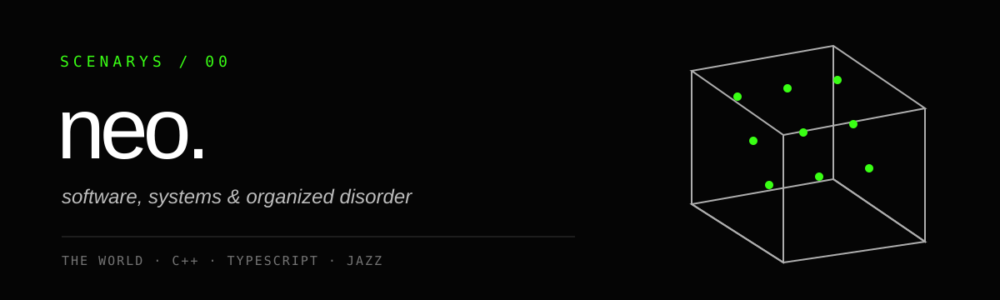

<p align="center">
  
</p>

<p align="center">
  <em>todas las perspectivas caben en una sola.</em>
</p>

---

### `neo.`

Construyo sistemas donde **la técnica**, *la intuición* y el ruido aprenden a
respirar juntos.

No separo demasiado el código de la música. En ambos casos hay una estructura,
un silencio y algo que decide romperlos en el momento exacto.

> **orden suficiente para no perder el caos.**  
> *caos suficiente para encontrar algo nuevo.*

```text
the world
└── scenarys
    ├── choisys          decisiones → recorridos → representación
    ├── neos-cube       C++ · 3 × 3 × 3 · núcleo local
    └── neo-cube-web    geometría pública para gente razonablemente loca
```

### ahora mismo

- diseñando **choisys**, una experiencia de decisión en tres fases;
- construyendo el **Cubo de Neo** con C++ y una frontera pública pequeña;
- haciendo que Mac, PC, iPhone y GitHub trabajen como un solo instrumento;
- convirtiendo procesos repetidos en comandos que caben en una línea;
- dejando que el software improvise, pero nunca que pierda el compás.

### piezas en movimiento

| proyecto | pulso |
|---|---|
| [**choisys**](https://github.com/NeoRetroo38/choisys) | producto, interfaz y API pública |
| [**neos-cube**](https://github.com/NeoRetroo38/neos-cube) | motor C++ local y determinista |
| [**neo-cube-web**](https://github.com/NeoRetroo38/neo-cube-web) | geometría 3D y SVG reutilizable |

### método

**Leo despacio. Construyo rápido. Verifico dos veces.**

Trabajo en ramas pequeñas. Los cambios llegan como pull requests. El motor no
se mezcla con la interfaz. Los secretos no entran en los repositorios. Si algo
no sobrevive a un reinicio, todavía no está terminado.

El equipo tiene tres voces:

`neo` — dirección, criterio y manos  
`daemon` — terminal, arquitectura y memoria operativa  
`claude` — interfaz, contraste y otra forma de mirar

No importa demasiado qué frase escribió quién. Importa que **el sistema
funcione**, que la decisión sea humana y que quede espacio para la siguiente
improvisación.

---

<p align="center">
  <strong>samurai's code.</strong><br />
  <em>compilo como improviso: escuchando el error.</em>
</p>
